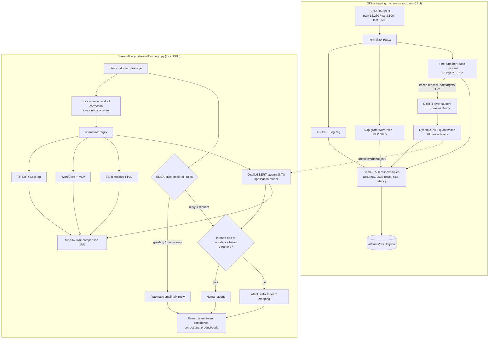

# Homework map and presentation checklist

## Chosen use case

Use Case 2: Customer Support Ticket Router, evaluated on CLINC150 `plus`. The benchmark's 150 intents plus the out-of-scope class serve as a general support-routing prototype, so all model comparisons use one public, held-out dataset. The interface also has illustrative appliance product/model-code extraction, but it is **not** evaluated on an appliance-specific dataset, and no appliance fault classifier was trained.

## Requirement-to-code map

| Requirement | Project component | Evidence |
|---|---|---|
| R1 Interactive application | `app.py` (Streamlit), `streamlit run app.py` | Live demo with new inputs, including an OOS / low-confidence case |
| R2 Four technique areas | Technique map below | One slide |
| R3 Four-model ladder, same test split | `src/train.py` (`predictors` dict, `benchmark()`) | `artifacts/results.json["models"]`; every model has `test_examples = 5500` |
| R4 Accuracy, OOS recall, size, latency (≥100 runs), hardware | `src/train.py: benchmark()`, `hardware_info()` | `results.json`: `accuracy`, `out_of_scope_recall`, `size_mb`, `latency_ms_mean`, `latency_runs`, `hardware` |
| R5 Distilled + quantized model in app | `app.py: load_models()` → `src/models.py: load_int8_student("artifacts/student_int8")` | App refuses to start if that artifact has as many layers as the teacher or no INT8 layers |
| R6 Architecture diagram | Diagram below; rendered version on slide 4 of `presentation/SWE015_Support_Ticket_Router_Presentation.pdf` | Matches `app.py` and `src/train.py` |
| R7 Repository | `README.md`, `requirements.txt`, `.gitignore` excludes `artifacts/` | One train command, one run command |
| R8 AI usage statement | Slide 12 of the presentation PDF (text in `PRESENTATION.md`) | Add your own contributions where the slide has a placeholder |

## Technique map

| Area | Technique | Where it appears |
|---|---|---|
| A · Neural networks | Skip-gram Word2Vec (gensim, trained on CLINC train texts), mean-pooled 100-d sentence vectors, feedforward MLP 100→128→151 (ReLU, dropout 0.2) trained with SGD + momentum via backpropagation | `src/train.py: train_mlp`, `src/models.py: MeanEmbeddingMLP, mean_vectors` |
| B · Classical NLP | Regex normalization and model-code extraction; Levenshtein edit-distance product-name correction; ELIZA-style small-talk rules with pronoun reflection; TF-IDF (1–2-grams) + logistic regression | `src/data.py`, `app.py: edit_distance, correct_product_text, small_talk_reply`, `src/train.py` |
| C · Transformers | Fine-tuned `bert-base-uncased` sequence classifier (12 layers, 151 labels) | `src/train.py: train_models` |
| D · Efficient models | Knowledge distillation into a 4-layer BERT student (soft teacher targets T=2 + hard labels, α=0.5), **then** dynamic INT8 quantization of the student's Linear layers | `src/train.py: create_student_model, train_student`, `src/models.py: quantize_int8, load_int8_student` |

## Architecture diagram

Everything runs locally on CPU (no GPU, no cloud service). Only the INT8 student drives routing; the other three models are shown for comparison.

## Before submission

- Done: training completed on the development laptop (`artifacts/train.log`), and the benchmark completed with `--evaluate-only` (`artifacts/eval.log`, `artifacts/results.json`). Measured numbers are in `PRESENTATION.md` and `README.md`.
- Keep a copy of `artifacts/results.json` and both logs. They are git-ignored, so they will not be pushed.
- Take app screenshots, including the failure case "how do i freeze my credit card" → `damaged_card` (66.4%).
- Add your name, student ID, repository URL and demo-video URL in `presentation/slides.html` (slide 1), then re-export the PDF.
- Record the narrated demo (live inputs, app, architecture, results table).
- Finalize the AI usage slide (slide 12) so it matches your actual use.
- Be ready to explain every component, including the distillation loss and why quantization is applied after distillation.
